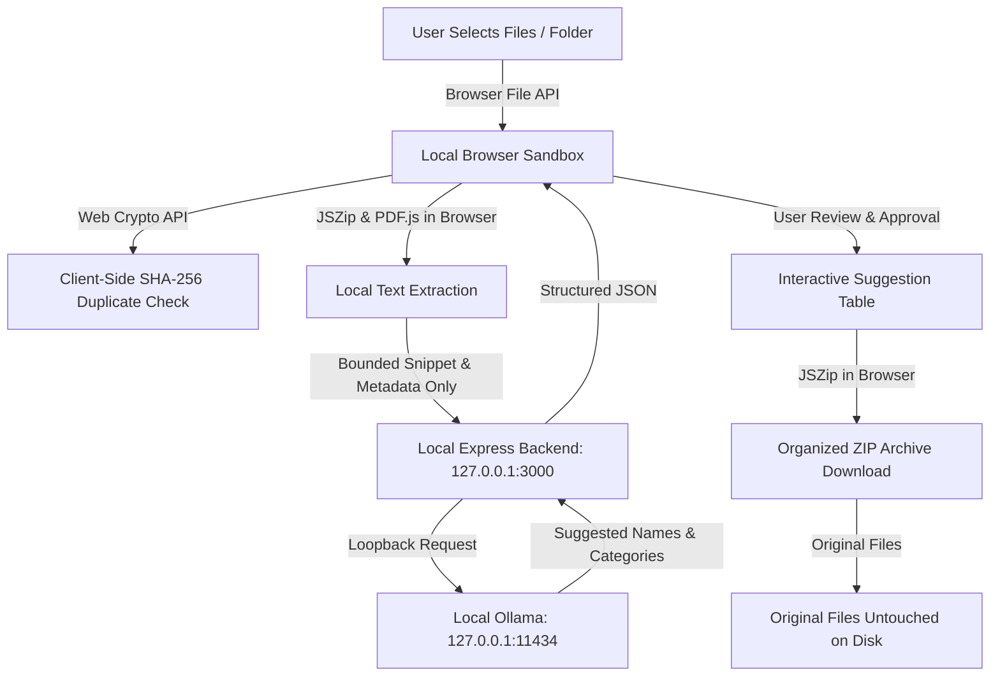

# ClutterPilot

> **"Your files are a mess. Fixing them shouldn't be another task."**  
> *Understand your digital clutter, preview a smarter structure, and organize your files without risking the originals.*

---

ClutterPilot is a **privacy-first, local-AI file organization web application**. It runs entirely on your own machine, leveraging local browser APIs and an on-device Large Language Model ([Ollama](https://ollama.ai) with `qwen2.5:1.5b`) to inspect file clutter, suggest clean naming and categorization schemes, detect exact duplicates, and export a neatly organized ZIP archive—leaving your original files 100% untouched.

---

## Key Features

- **100% Local-Only Architecture**: Zero cloud servers, zero analytics, zero telemetry, and zero remote CDNs. The Express backend is strictly bound to `127.0.0.1`.
- **Private Browser Processing**: File reading, metadata extraction, SHA-256 duplicate hashing, and ZIP compilation execute directly in your browser. Raw file bytes never leave your browser window.
- **On-Device AI Inference**: Uses a local Ollama instance (`qwen2.5:1.5b`) at `127.0.0.1:11434`. Only bounded text snippets (~250 chars) and file metadata are sent locally for inference.
- **Smart Rule Fallbacks**: Deterministic heuristic rules provide instant suggestions (<10ms) so you can organize files immediately even if Ollama is loading or unavailable.
- **Interactive Review Table**: Full control over every AI recommendation. Approve, edit suggested names, modify target folder categories, or skip files individually and in bulk.
- **Duplicate Detection**: Identifies exact file duplicates client-side via Web Crypto SHA-256 and flags them for review to save disk space.
- **Zero Risk to Originals**: Generates a downloadable organized ZIP archive in-browser. Your original disk files are never modified, moved, or deleted automatically.
- **Ephemeral Session Memory**: No user files or text are stored in `localStorage`, `IndexedDB`, or cookies. The **Reset Workspace** feature instantly purges all session objects and revokes URLs.
- **Light & Dark Theme**: High-contrast, accessible design system tailored for readability in both light and dark modes.
- **Built-in Interactive Demo**: Test all features instantly with 10 realistic cluttered sample files without selecting personal documents.

---

## Architecture & Data Flow



---

## Prerequisites

1. **Node.js** (v18.0.0 or later recommended)
2. **Ollama** installed and running on your machine:
   - Download Ollama from [ollama.ai](https://ollama.ai)
   - Pull the recommended lightweight model:
     ```bash
     ollama pull qwen2.5:1.5b
     ```
   - Ensure the Ollama daemon is active (default address: `http://127.0.0.1:11434`).

---

## Quick Start

1. **Clone the repository:**
   ```bash
   git clone <your-repo-url>
   cd Clutterfit
   ```

2. **Install dependencies:**
   ```bash
   npm install
   ```

3. **Start the application:**
   ```bash
   npm start
   ```

4. **Open in your browser:**
   - Landing page: [http://127.0.0.1:3000](http://127.0.0.1:3000)
   - Workspace app: [http://127.0.0.1:3000/workspace](http://127.0.0.1:3000/workspace)
   - Instant Demo: [http://127.0.0.1:3000/workspace?demo=true](http://127.0.0.1:3000/workspace?demo=true)

---

## Project Structure

```text
├── docs/
│   ├── DEMO_SCRIPT.md          # 3-minute video / live demonstration script
│   └── SUBMISSION.md           # Architecture, privacy verification, and project narrative
├── public/
│   ├── vendor/
│   │   ├── jszip.min.js        # Local vendor bundle for client-side ZIP & DOCX parsing
│   │   ├── pdf.min.mjs         # Local vendor bundle for client-side PDF text extraction
│   │   └── pdf.worker.min.mjs  # Local web worker for PDF extraction
│   ├── app.js                  # Workspace client logic (Web Crypto, AI calls, table, export)
│   ├── index.html              # Standalone marketing & privacy landing page
│   ├── landing.js              # Landing page UI logic (health heartbeat, FAQ, theme)
│   ├── style.css               # Warm cream / deep forest green responsive design system
│   └── workspace.html          # Dedicated 5-step workspace application
├── .gitignore                  # Git ignore rules (node_modules, logs, OS files, secrets)
├── package.json                # Project dependencies and npm scripts
├── package-lock.json           # Locked dependency tree
├── README.md                   # This documentation file
└── server.js                   # Express server bound to loopback 127.0.0.1:3000
```

---

## Privacy & Security Verification

- **Strict Loopback Binding**: `server.js` explicitly binds to `127.0.0.1` (never `0.0.0.0`), preventing unintended local-network exposure.
- **Zero External Network Calls**: All vendor libraries ([JSZip](https://stuk.github.io/jszip/), [PDF.js](https://mozilla.github.io/pdf.js/)) are self-hosted in `public/vendor/`. No CDNs, tracking scripts, or remote web fonts are loaded.
- **Zero Persistent Storage**: User files, extracted document text, and generated recommendations are kept strictly in transient JavaScript memory during the active session. Only the user's theme preference (`clutterpilot-theme`) is stored in `localStorage`.
- **Safe ZIP Generation**: Organized files are bundled into a new `.zip` archive client-side. The user's original files remain completely untouched on their disk.

---

## License

ISC License.
