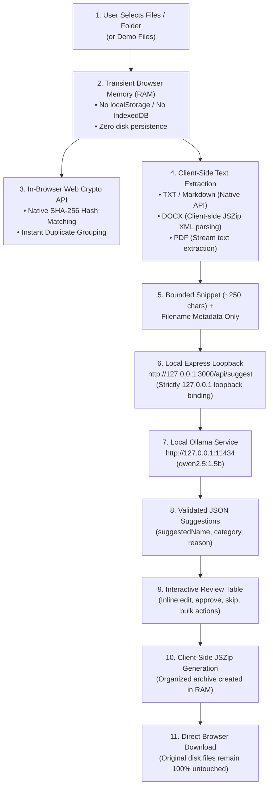

# ClutterPilot — The Privacy-First, On-Device AI File Organizer

> **"Your files are a mess. Fixing them shouldn't be another task."**
> Understand your digital clutter, preview a smarter structure, and organize your files without risking the originals.

---

## 1. Project Overview

Every day, download folders, desktop screens, and project directories become digital graveyards of poorly named files: `download (4).pdf`, `document_001.pdf`, `notes_final_FINAL.docx`, and random phone camera screenshots like `IMG_2026_01.jpg`. 

Existing cloud organization utilities demand that users upload their personal documents, financial receipts, medical records, and university assignments to remote cloud servers for analysis. For privacy-conscious individuals, students, researchers, and enterprises, uploading sensitive personal data to remote AI APIs is unacceptable.

**ClutterPilot** solves this problem by bringing intelligent file organization completely to the user's local machine. Powered by an on-device local Large Language Model (`qwen2.5:1.5b` via **Ollama**), ClutterPilot evaluates document context, detects duplicates, suggests clean descriptive filenames and hierarchical folder categories, and packages an organized ZIP archive—**with 100% of processing remaining on the user's computer.**

---

## 2. Core Value Propositions

- **100% On-Device AI**: Inference runs locally through Ollama. No personal documents, text snippets, or filenames are ever transmitted to an external server or remote API.
- **Zero Cloud Storage & Forensic Cleanliness**: ClutterPilot writes zero user files to `localStorage`, `sessionStorage`, `IndexedDB`, cookies, or remote databases. Data is processed exclusively in transient browser RAM during the active session.
- **SHA-256 Client-Side Duplicate Detection**: Exact binary duplicates are identified instantaneously in the browser using the native Web Crypto API.
- **Safe Review & Non-Destructive Export**: ClutterPilot never modifies, deletes, or overwrites original files on disk. Users review, edit, approve, or skip every suggestion before exporting a clean, organized ZIP archive generated client-side with JSZip.
- **Always Available with Rule Heuristics**: If the local AI model is offline or busy, ClutterPilot seamlessly falls back to deterministic rule heuristics, guaranteeing an uninterrupted workflow.

---

## 3. Privacy-First Architecture

### Privacy Guarantees
1. **Loopback Only (`127.0.0.1:3000`)**: The Express server binds strictly to the local loopback address `127.0.0.1`, not `0.0.0.0`.
2. **Zero Telemetry & Zero CDNs**: No Google Fonts, external analytics, tracking pixels, or third-party CDN scripts. All libraries (`jszip.min.js`, `pdf.min.mjs`) are served locally.
3. **Prompt Injection Hardening**: All user text snippets and filenames are strictly treated as untrusted data within the system prompt to prevent prompt injection.
4. **Instant Workspace Reset**: Tapping **"Reset Workspace"** completely nullifies in-memory arrays, clears DOM elements, revokes all blob URLs, and restores the initial empty state.

---

## 4. User Journey & Feature Walkthrough

### Step 1: File Selection (`/workspace`)
- Drag-and-drop zone supporting multiple files and folder directory selection (`webkitdirectory`).
- Built-in **"Try a demo instead"** feature that generates 10 realistic cluttered files (assignments, financial reports, duplicates, camera captures) so anyone can test the product immediately without using personal files.

### Step 2: Scanning & Local Audit
- Real-time progress bar computing SHA-256 hashes and extracting text snippets.
- Stat indicators displaying Total Files, File Types, Possible Duplicates, and Files Requiring Review.
- Step-by-step audit checklist visualizing the local processing stages.

### Step 3: Clutter Audit Report
- 5 high-level metrics: Total Files, File Types, Exact Duplicates (red-tinted), Unclear Names (amber-tinted), and Unsupported formats.
- 3 detailed breakdown panels:
  1. **File Types**: Visual distribution bar meters across PDFs, images, plain text, and Word documents.
  2. **Quick Insights**: Actionable observations about duplicate copies and generic naming patterns.
  3. **Duplicate Files**: Grouped duplicate clusters identified by identical cryptographic hashes.

### Step 4: AI Suggestions Review Table
- Responsive data table presenting Original File, AI Suggested Name, Category/Subfolder, Reason, and Confidence Pill (`High`, `Medium`, `Low`).
- Individual approval toggles (`✓`) and inline edit pencils opening a modal to customize names and categories.
- Bulk action controls: `Select All`, `Approve Selected`, and `Skip Selected`.

### Step 5: Export Preview & ZIP Packaging
- Interactive folder tree view illustrating the resulting directory hierarchy (`Documents/Assignments/`, `Receipts/`, `Images/Personal/`, etc.).
- One-click **"Download Organized Files (.ZIP)"** assembled completely client-side in browser RAM.
- Original files on the user's filesystem remain 100% untouched.

---

## 5. Technology Stack

- **Backend**: Node.js & Express (strictly bound to `127.0.0.1:3000`).
- **AI Model & Inference**: Ollama running `qwen2.5:1.5b` on `127.0.0.1:11434`.
- **Frontend**: Vanilla JavaScript (ES6+), HTML5, CSS3 with responsive Grid/Flexbox and CSS custom properties.
- **Client Libraries (Self-Hosted, Zero CDN)**:
  - `JSZip`: In-browser ZIP archive compilation and DOCX XML extraction.
  - Native `crypto.subtle.digest`: In-browser SHA-256 hashing.
- **Design System**: Warm Cream (`#FAF8F5`), Deep Forest Green (`#123325`), Sage Green (`#4A7A5E`), with full high-contrast dark mode support (`data-theme="dark"`).

---

## 6. Verification & Results

- **Network Boundary Test**: Zero external HTTP/HTTPS calls made; 100% offline capable.
- **Storage Audit**: Zero file contents or extracted text written to browser storage or server logs.
- **Inference Speed**: Bounded prompts (~250 chars) and optimized token limits (`num_predict: 90`) ensure snappy response times even on CPU-only machines.
- **Reliability**: Deterministic heuristic rules ensure full organization functionality even if Ollama is paused or unavailable.
